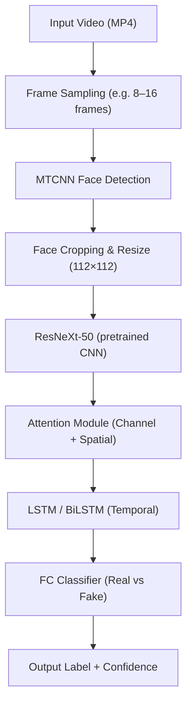

# Deepfake Video Detection PRD & Roadmap

**Executive Summary:** We will build a deepfake detector that takes an input video (≈5–30 s) and classifies it as Real or Fake.  The system uses a face-centric pipeline (frame sampling → MTCNN face detection → 112×112 face crops → ResNeXt-50 spatial features → attention module → LSTM temporal modeling → classifier).  It is trained primarily on the FaceForensics++ (FF++) C23 dataset and evaluated on independent benchmarks (Celeb-DF v2, DFDC). The RTX 3050 (6 GB) constraint drives design choices (small crops, mixed-precision, gradient accumulation).  We include cross-dataset tests and ablations (e.g. with/without attention or LSTM) to ensure generalization.  Final deliverables: a documented pipeline, trained model checkpoints, evaluation reports (accuracy, F1, AUC, EER), and a simple inference API/UI.  The design is **future-proof**: modular components allow swapping in newer backbones (e.g. future CNNs or Transformers), continual learning with new data, and scalable deployment.  

## Scope & Objectives  
- **Goal:** Detect whether an uploaded video has been manipulated (deepfaked) with high accuracy and robustness.  
- **Scope:** Offline (non real-time) analysis of face-based manipulations in video. The focus is on facial identity and expression forgeries (e.g. FaceSwap, Face2Face, DeepFakes, NeuralTextures) rather than scene edits.  
- **Objectives:** Achieve state-of-art-like performance on FF++ C23 (target ≥92% accuracy/AUC) and strong cross-dataset generalization (test on Celeb-DF v2, DFDC). Operate within the 6 GB VRAM limit (use 112×112 face crops, FP16, small batches). Ensure reproducibility (fixed seeds, config files) and compliance with dataset licenses.  

## Target Users & Use Cases  
- **Target Users:** Social media platforms, news organizations, forensics analysts, content moderators, and researchers who need to verify video authenticity.  
- **Use Cases:** Bulk-scanning video datasets for deepfakes, vetting user-uploaded videos, academic research. System may expose an API or web UI to upload a short video and receive *Real/Fake + confidence*.  

## Success Criteria  
- **Accuracy & Robustness:** High detection rates on in-domain data (FF++) and maintained performance on unseen domains (Celeb-DF v2, DFDC).  We aim for ≥90% accuracy and ≥0.95 AUC in-domain, with minimal drop on cross-dataset tests.  
- **Performance:** The model should run efficiently on an RTX 3050 (6 GB), processing video at near real-time (e.g. ≤50 ms per frame).  
- **Reliability:** Fully automated pipeline from video upload to verdict. Reproducible results (fixed random seeds, versioned code).  
- **Privacy & Security:** Uploaded videos are processed securely (TLS, encrypted at rest), not retained beyond processing. Compliance with data terms (datasets used only for research) and privacy regulations (GDPR, etc.).  

## Non-Functional Requirements  
- **Memory/VRAM:** Use face crops of size **112×112** (as in prior work) to fit model on 6 GB GPU. Employ **FP16 mixed precision** and **batch size 8–16** to reduce memory use. Use gradient accumulation if needed for effective batch size.  
- **Latency & Throughput:** Aim for ~20–40 FPS inference speed on RTX 3050. (A reference model ran at ~45 ms/frame on a mid-range GPU.) Batch inference (per video) should complete within seconds.  
- **Scalability:** Design modular code so that backbones, attention modules, or data pipelines can be replaced/upgraded (e.g. switch to EfficientNet or Vision Transformer) as new techniques emerge.  
- **Security & Privacy:** Process videos in-memory or ephemeral storage. Encrypt data-at-rest. Ensure no models memorize sensitive identity information. Follow terms of use for datasets (FaceForensics++ Terms of Use, Celeb-DF “Terms to Use”, DFDC usage policy).  
- **Compliance:** Only use FF++, Celeb-DF v2, and DFDC data for research/education. Cite datasets properly.  

## Data Sources & Licensing  
| Dataset            | Size & Content                            | Access & Notes                                              |
|--------------------|-------------------------------------------|-------------------------------------------------------------|
| **FaceForensics++ (FF++)** – C23 | 1000 real videos (1080p), each with 4 fakes (DeepFakes, Face2Face, FaceSwap, NeuralTextures). ~5000 total videos (plus 1000 unlabeled for challenge). | Official download requires request via Google form. Data released under FaceForensics++ Terms of Use (research only). Preferred source: project website or [GitHub repo]. For VRAM, we sample frames. |
| **Celeb-DF v2**    | 590 real celebrity videos, 5639 DeepFake videos (6229 total). High-quality face swaps with reduced artifacts. | Request via authors’ Google/Tencent form. “Terms to Use” license (as-is, research only). Use the Buffalo CSE site or GitHub. |
| **DFDC (Full)**    | ~23,654 real + 104,500 fake videos (3426 actors, 8 generation methods). Large, diverse (scene, lighting, audio). | Hosted by Meta (Facebook) AI. Access via AWS (requires AWS account and keys) or Kaggle. Cite DFDC papers. Use only preview/full data per policy. |

All datasets require applying/access via forms or platforms. We will download and preprocess them externally (not include raw videos in repo). For development, consider using small subsets or the Kaggle preview sets. Follow official instructions.  

## Data Preprocessing Pipeline  
1. **Frame Sampling:** Extract *N* frames per video (e.g. 8–16 frames uniformly or at fixed rate). We will avoid full-video decoding to save memory.  
2. **Face Detection (MTCNN):** For each frame, run MTCNN to locate faces. MTCNN is lightweight and works under varied lighting.  
3. **Face Cropping & Resizing:** Crop the largest face from each frame (or track multiple faces later) and resize to **112×112**×3. Discard frames with no clear face.  
4. **Data Augmentation (optional):** On-the-fly augmentations (random horizontal flip, brightness/contrast jitter, small rotations) to improve robustness. Ensure consistency across face sequence.  
5. **Normalization:** Normalize pixels (e.g. per ImageNet mean/std) before feeding into model.  
6. **Sequence Packaging:** Stack face crops into a fixed-length tensor (e.g. T×3×112×112). We may pad or randomly select contiguous frames if videos have variable lengths.  

Throughout, log the number of faces and frames per video. Save processed tensors or use a dataloader to extract on-the-fly. We will benchmark the MTCNN and frame extraction to ensure GPU is not overloaded (MTCNN runs on CPU/GPU).  

## Model Architecture  

>  *Figure: Proposed pipeline. Sampled video frames → MTCNN face detection → 112×112 face crops → ResNeXt-50 spatial features → Attention module (channel + spatial) → LSTM/BiLSTM temporal aggregation → FC classifier → Real/Fake decision.*  

1. **Spatial Backbone (ResNeXt-50):** Use ResNeXt-50 (32×4d) pretrained on ImageNet. It extracts a 2048-d feature map from each 112×112 face. ResNeXt adds cardinality (parallel paths) for richer features. We may freeze lower layers initially, then fine-tune. BatchNorm and global average pooling compress to a vector.  
2. **Attention Module:** Following Lal et al. (2025), apply a lightweight **soft attention** over spatial features. We may use a dual attention (channel-wise + spatial-wise, e.g. CBAM-style) to highlight forged artifacts. This produces a weighted “context” vector per frame. (Alternatively test single soft-attn as ablation.)  
3. **Temporal Model (LSTM/BiLSTM):** Sequence the frame feature vectors into an LSTM (or BiLSTM) to capture temporal inconsistencies. For instance, a 2048-unit BiLSTM (dropout ~0.5) processes the T×2048 inputs. The final hidden state (or attention-weighted output) summarizes temporal evidence.  
4. **Classifier Head:** A small MLP (one or two FC layers) on the LSTM output ending in a sigmoid/softmax for Real vs. Fake. Use cross-entropy or binary cross-entropy loss.  

The mermaid flowchart below illustrates this pipeline:  

> **Note:** This design is **modular**: any block (e.g. ResNeXt, attention type, LSTM) can be replaced or upgraded in future work (e.g. EfficientNet backbone, Transformer encoder) without re-engineering the pipeline.

## Training Regime  
- **Batch size & Precision:** Use small batches (8–16) due to 6 GB VRAM, with **mixed precision (FP16)** in PyTorch for memory savings.  
- **Optimizer & LR:** Adam optimizer. Start at `lr=1e-3` (or 1e-4) and reduce on plateau (factor 0.1). No momentum needed. Use weight decay (~1e-5) for regularization.  
- **Epochs:** ~50–100 epochs on FF++ (C23). Monitor validation AUC to choose best model. Use early stopping if no improvement for 10 epochs.  
- **Gradient Accumulation:** If needed to simulate larger batch, accumulate gradients over 2–4 steps before `optimizer.step()`.  
- **Checkpointing:** Save model every epoch or when validation AUC improves. Keep last checkpoint and best checkpoint by AUC.  
- **Cross-Validation:** Optionally 5-fold CV on FF++ to validate stability (as in Sci Reports).  
- **Data Sampling:** For each video, randomly sample frames each epoch (data augmentation in time), or use fixed spacing. Ensure each video is seen multiple ways.  
- **Fine-Tuning:** Initially freeze some ResNeXt layers (to save memory) and train classifier/LSTM. Then unfreeze last ResNeXt block for fine-tuning if VRAM allows.  

## Evaluation Plan  
- **Within-Dataset (FF++):** Split the 1000 videos into train/val/test (e.g. 70/15/15) or use 5-fold CV. Evaluate accuracy, precision, recall, F1, ROC-AUC, and EER. Report per-manipulation performance as well.  
- **Cross-Dataset Testing:** Train on **FF++ C23**, then test on the **Celeb-DF v2** and **DFDC** sets. This measures generalization.  
- **Metrics:** Compute (at minimum) Accuracy, Precision, Recall, F1-score, ROC-AUC, and Equal-Error Rate (EER). Also log inference time per frame. Use 5-fold CV means ± std to report stability.  
- **Threshold Selection:** For ROC/EER, sweep detection threshold. For final system, a confidence score is output.  
- **Ablation Studies:** Compare model variants (see **Experiment Matrix** below). Key ablations include: removing attention module, using only spatial or only channel attention, replacing BiLSTM with unidirectional LSTM, etc. Measure how each change affects metrics (expected 3–10% impact as per [25]).

## Experiment Matrix  
We will systematically evaluate combinations of model components. Example plan:

| Model Variant                    | Dataset(s)                | Metrics                                        |
|----------------------------------|---------------------------|------------------------------------------------|
| **Baseline:** ResNeXt-50 + LSTM   | FF++ (train/test split)   | Acc, Precision, Recall, F1, AUC, EER           |
| + **Soft Attention** on LSTM      | FF++                     | As above                                      |
| + **CBAM** (Dual channel+spatial) | FF++                     | As above                                      |
| **BiLSTM instead of LSTM**       | FF++, Celeb-DF, DFDC      | As above                                      |
| **No Attention**                 | FF++, Celeb-DF, DFDC      | As above                                      |
| **Cross-Dataset Tests:** Train on FF++, test on Celeb-DF v2 and DFDC (each) | FF++→Celeb-DF, FF++→DFDC | AUC, EER (generalization)                      |
| **Other Ablations:** vary #frames, freeze vs. fine-tune, different backbones (ResNet-50, EfficientNet)* | Subsets of above | Key metrics                                  |

*“Other Ablations” include trying ResNet-50 or newer CNNs if time permits.  
This matrix ensures we measure impact of each component. We expect, for example, that adding the attention module improves AUC by ~4–5% and using BiLSTM improves temporal consistency detection.

## Reproducibility  
- Fix all random seeds (Python, NumPy, PyTorch). Log seed in outputs.  
- Use a single conda/venv environment (`requirements.txt` or `environment.yml`) with exact library versions (PyTorch, CUDA, etc).  
- Version all code in Git with meaningful commits. Tag checkpoints with Git commit hashes.  
- Provide config files (YAML/JSON) for each experiment (hyperparameters, data paths).  
- Document experiment commands and parameters. Consider using a tool like MLflow or Weights&Biases for logging.  

## CI/CD & Deployment  
- **Continuous Integration:** Basic tests (unit tests) for data loader, model instantiation, and inference on dummy data. Automated style/format checks (flake8).  
- **Training Pipeline:** Can use GitHub Actions or similar to auto-trigger training/evaluation on push (for small data/tests).  
- **Model Serving:** Export final model as a TorchScript or ONNX for inference. Write a simple CLI or REST API (e.g. FastAPI) that accepts a video file, runs the pipeline, and returns JSON `{label, confidence}`. Dockerize the service for portability.  
- **Deployment Options:** 
  - **Local GPU:** Provide installation instructions to run on a local machine with RTX 3050. 
  - **Cloud:** (Optional) Container can be deployed on a GPU VM or even a CPU-based inference if performance allows (with smaller batch). For wider distribution, consider quantization or pruning for edge devices.  
- **Future Updates:** Set up a process to periodically retrain the model with new deepfake data. The modular design (separate data/architecture code) makes updates straightforward.

## UX/API Considerations  
- **Input Limits:** Recommend ≤30 s videos (~100–300 frames). The API/UI should reject extremely large uploads (e.g. >100 MB) or long durations, or process them in chunks.  
- **Sampling Defaults:** Default to sampling ~10–16 frames per video uniformly. Allow configuring the sampling rate and number of frames via API parameters.  
- **Multi-Face Handling:** Initially, we will process the largest detected face per frame. For videos with multiple people, the API could either flag video-level Fake if *any* face is fake, or eventually return per-face results.  (Future extension: track and classify each face independently.)  
- **Output:** Return binary label (Real/Fake) with probability/confidence (softmax output). For UX, display “Deepfake Detected” if confidence > threshold.  
- **Privacy:** Inform users (via UI/API doc) that videos are not stored beyond processing. Implement HTTPS and, if cloud, use user-isolated storage (S3, etc.) with expiration.  

## Risks & Mitigations  
- **Domain Overfitting:** Model may overfit FF++ style. *Mitigation:* Use data augmentation, freeze backbone initially, and rely on cross-dataset tests. Continually validate on Celeb-DF and DFDC.  
- **Evolving Deepfakes:** Future deepfake tech may slip past our model. *Mitigation:* Keep architecture modular to swap in new detectors (e.g. audio checks, CNN upgrades). Consider continual learning (fine-tune on new samples). Monitor research for new features (eye artifacts, motion cues).  
- **Hardware Limitations:** 6 GB VRAM may restrict model size. *Mitigation:* Use FP16, small images, gradient accumulation. If memory issues persist, simplify architecture (e.g. fewer LSTM layers).  
- **Dataset Licensing:** Non-commercial/public release only. *Mitigation:* Ensure the final product (code/model) is for research use and respects licenses. Do not redistribute raw data.  
- **Bias & Privacy:** Model trained on limited identities (e.g. FF++ actors, celebrities). It may perform unevenly across skin tones or ages. *Mitigation:* Evaluate on diverse test sets; consider fairness metrics. Also, secure user data in API.  
- **False Positives/Negatives:** Risk of mislabeling real video as fake or vice versa. *Mitigation:* Tune decision threshold to balance precision/recall. Possibly provide a “confidence” indicator in the UI.

## Resources & Timeline  

- **Hardware:** Training on RTX 3050; expect longer runs than top-end GPU. For planning, assume ~20–50 GPU-hours total. (Sci Reports ran on 3090 in ~101 epochs; on 3050 this may take ~2× longer).  
- **Storage:** FF++ (~>500 GB), Celeb-DF (~70 GB), DFDC (~1–2 TB). We will store only a working subset (e.g. 10% of DFDC or just preview). Processed faces (~few GB) can be cached.  
- **Team & Skills:** Assumes 1–2 ML engineers. Intermediate PyTorch experience required.  
- **Milestones (example sprints, 2 weeks each):**

| **Sprint** | **Tasks & Deliverables**                                |
|------------|---------------------------------------------------------|
| **1** – Setup & Data      | *Tasks:* Obtain dataset access; implement frame extractor + MTCNN cropping; script to preprocess FF++ into face-image sequences.  *Deliverables:* Preprocessing pipeline code; sample processed dataset; documentation of dataset usage. |
| **2** – Baseline Model    | *Tasks:* Implement ResNeXt-50 + LSTM model; train baseline on a small subset; set up training loop & logging.  *Deliverables:* Initial model code; training logs; baseline performance on FF++ (no attention). |
| **3** – Attention Module  | *Tasks:* Integrate attention (soft or CBAM) into model; experiment with spatial vs. channel attention.  *Deliverables:* Improved model code; ablation results comparing with/without attention; updated metrics table. |
| **4** – Full Training     | *Tasks:* Train full model (ResNeXt + attention + LSTM) on FF++ C23; tune hyperparameters.  *Deliverables:* Final trained checkpoint; plots of loss/metrics; within-FF++ evaluation report. |
| **5** – Cross-Dataset Eval| *Tasks:* Test trained model on Celeb-DF v2 and DFDC; perform error analysis.  *Deliverables:* Cross-dataset performance report (AUC, etc.); confusion matrices; error cases. |
| **6** – Ablations & Writeup| *Tasks:* Complete ablation experiments (e.g. remove LSTM, try BiLSTM); finalize metrics. Begin writing final report (PRD) and documentation.  *Deliverables:* Ablation results table/plots; draft report sections. |
| **7** – CI/CD & UX       | *Tasks:* Develop inference API/CLI; Dockerize deployment; set up basic CI.  *Deliverables:* Inference script or app; container image; example inference on test video; CI pipeline. |
| **8** – Finalization      | *Tasks:* Polish code; ensure reproducibility (seed, env file); finalize PRD and code documentation.  *Deliverables:* Full repository; final report with roadmap; deliverables package. |

Timeline totals ~16 weeks. Adjust as needed.  

## Hyperparameters (RTX 3050 Tuning)  

| Hyperparameter           | Recommended Value        |
|--------------------------|--------------------------|
| Face crop size           | 112×112 pixels |
| Frames per video         | 8–16 (configurable)      |
| Batch size               | 8–16 (with FP16)         |
| Optimizer                | Adam                     |
| Learning rate (init)     | 1e-3 (reduce on plateau) |
| Weight decay             | 1e-5                     |
| Epochs                   | 50–100 (monitor metrics) |
| LSTM hidden units        | 2048 (dropout 0.5) |
| Attention type           | Soft-attention or CBAM (dual) |
| Data aug                 | Random flip, color jitter (moderate) |
| Precision                | Mixed FP16              |
| Gradient accumulation    | (Optional) 2–4 steps to simulate larger batch |

(*Values are examples; final tuning needed.*)

## Checkpoints & Artifacts Naming  

| Artifact        | Naming Convention                                   |
|-----------------|-----------------------------------------------------|
| **Model Checkpoint**  | `deepfake_{backbone}_{attention}_{temporal}_FF++C23_run{N}_epoch{E}_AUC{0.000}.pth`    e.g. `deepfake_ResNeXt50_CBAM_BiLSTM_FFC23_run1_epoch50_AUC0.928.pth` |
| **Training Log**      | `trainlog_{backbone}_{run}{N}.txt`  (contains epoch metrics) |
| **Config File**      | `config_{experimentName}.yaml`  (hyperparameters, data paths) |
| **Experiment Report** | `report_{set}_{modelVariant}.md` (e.g. `report_FF++_baseline.md`) |
| **Docker/Image**     | `deepfake-detector:v{version}` (semantic versioning) |

All artifacts should include the date or Git commit hash in the project repository. Ensure checkpoints include both model and optimizer state for resumption.

## Future-Proofing  
- **Modularity:** The design (as above) allows easy swapping of components. If newer CNNs or Transformer-based visual models emerge, they can replace ResNeXt with minimal code change. Additional modalities (audio, motion) can be added as parallel inputs later.  
- **Continuous Learning:** Structure code to allow fine-tuning on new fake data. Periodically update the model as new deepfake methods appear.  
- **Monitoring:** Track performance drift by re-evaluating on latest benchmarks. If performance degrades, retrain with expanded dataset.  
- **Documentation & Community:** Release code under an open license for transparency. Encourage community feedback on new challenges, extending dataset coverage.

By following this roadmap, we will deliver a robust deepfake detection product, validated on standard benchmarks, deployable on commodity GPU, and extensible for future needs. 

**Sources:** Authoritative descriptions of FaceForensics++, Celeb-DF, DFDC; and the 2025 Scientific Reports methodology (ResNeXt-50 + attention + LSTM, cross-dataset evaluation) informed this plan. Each dataset’s official access/licensing guidelines were also referenced.