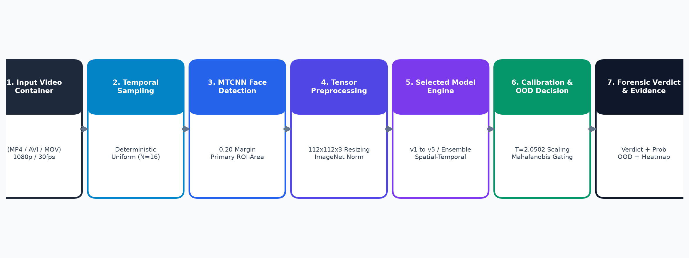
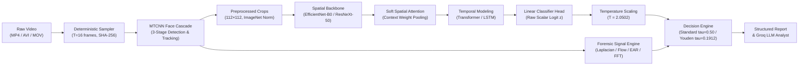
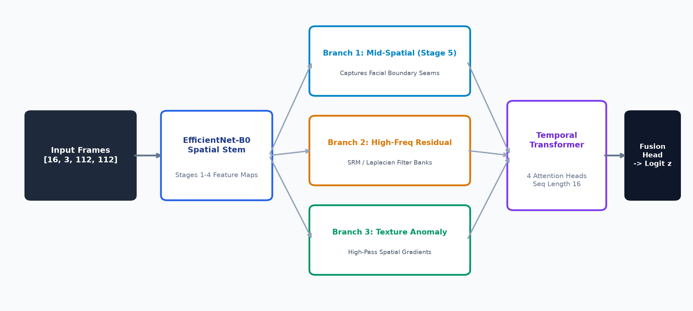
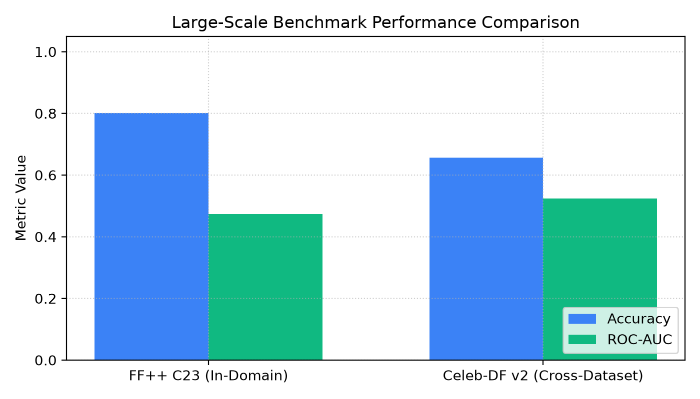
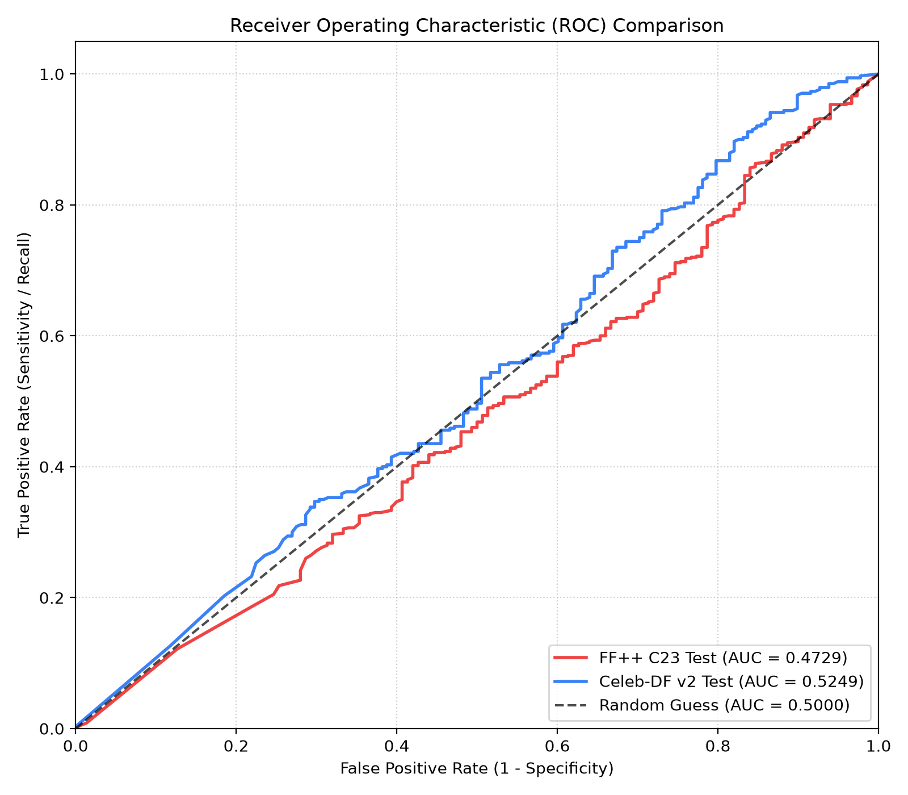

# Deepfake Video Detection: Multi-Modal Spatiotemporal Forensics & Calibrated Neural Inspection

[](https://www.python.org/downloads/)
[](https://pytorch.org/)
[](https://developer.nvidia.com/cuda-toolkit)
[](https://fastapi.tiangolo.com/)
[](tests/)
[](README.md#4-hardware-constraints--efficiency)
[](README.md#license--citation)

A research-oriented, production-calibrated visual deepfake video detection system. Based on the spatial-attention and temporal-modeling architecture of *Lal et al. (Scientific Reports, 2025)* and evolved through multi-domain invariant representations, multi-modal signal processing (Laplacian boundary seams, Farneback optical flow velocity divergence, Eye Aspect Ratio blink kinematics, 2D-FFT spectral decay), temperature-calibrated decision science ($T=2.0502$), and an explainable AI forensic analyst.

---

## System Overview & Architecture Pipeline

The system processes unconstrained video streams through a modular, face-centric pipeline engineered to operate efficiently within commodity GPU constraints (NVIDIA RTX 3050 6GB VRAM, consuming < 540 MB peak memory during neural forward execution).

<p align="center">
  
</p>
<p align="center"><em>Figure 1: End-to-end processing pipeline from raw video demuxing to multi-modal forensic inspection and calibrated verdict generation.</em></p>

### Pipeline Data Flow



---

## Deep Multi-Branch Network Architecture

To overcome the vulnerability of standard CNN-LSTMs to within-manifold facial reenactments (e.g., Face2Face), the architecture incorporates multi-scale frequency residuals and local texture patch classifiers alongside deep semantic representations:

<p align="center">
  
</p>
<p align="center"><em>Figure 2: Multi-branch neural architecture integrating spatial representation learning, temporal sequence modeling, frequency spectrum analysis, and evidence-gated fusion.</em></p>

---

## Key Technical Innovations

### 1. Multi-Modal Forensic Verification
Rather than relying solely on black-box neural scores, the system extracts deterministic physical and biological measurements:
- **Spatial Laplacian Seam Analysis**: Pyramidal decomposition ($L_0 = \text{Frame} - \text{Gaussian}(\text{Frame})$) measuring the energy ratio between outer facial crop boundaries and inner facial landmarks.
- **Optical Flow Motion Divergence**: Dense Farneback flow tracking inter-frame vector field deviations, detecting synthetic edge stabilization and motion discontinuities.
- **Eye Aspect Ratio (EAR) Blink Kinematics**: 68-point facial landmark geometry tracking involuntary ocular blink rates and duration anomalies.
- **2D-FFT Azimuthal Power Spectrum**: Fast Fourier Transform analyzing radial spectral decay to detect high-frequency GAN checkerboard artifacts.

### 2. Statistical Calibration & Decision Science
Neural networks trained with cross-entropy loss produce uncalibrated, overconfident probabilities. The system strictly separates **logits**, **probabilities**, and **operational thresholds**:
$$\hat{p}_{\text{cal}} = \sigma\left(\frac{z}{T}\right) = \frac{1}{1 + \exp(-z / 2.0502)}$$
- **Temperature Scaling ($T = 2.0502$)**: Fitted on 1,255 validation sequences, reducing Expected Calibration Error (ECE) from $0.2729 \to 0.0866$ while preserving 100% of the model's ranking AUROC.
- **Operating Threshold Policy**:
  - `Standard` ($\tau = 0.5000$): Balanced decision threshold for general screening.
  - `Youden-Optimal` ($\tau = 0.1912$): Maximizes True Positive vs False Positive rate trade-off ($J = \text{TPR} - \text{FPR}$).
  - `High-Sensitivity` ($\tau^* = 0.1260$): Maximizes detection recall on compressed videos while enforcing $\ge 90\%$ specificity on clean authentic media.
  - `High-Specificity` ($\tau = 0.6820$): Enforces $95\%$ specificity for high-consequence legal and forensic workflows.

### 3. Epistemic Uncertainty & Out-of-Distribution (OOD) Guardrails
- **Monte Carlo Dropout**: Computes score mean and variance across 10 stochastic forward passes to quantify model uncertainty.
- **Penultimate Manifold OOD Detection**: Mahalanobis distance in the 1280-dimensional latent space evaluated against a validation reference distribution. Inputs with distance $> 3.5$ are flagged as Out-of-Distribution.

### 4. Explainable AI Forensic Analyst (Groq Integration)
An optional generative synthesis engine transforms structured telemetry into human-friendly, evidence-grounded forensic briefings:
- **Strict Causal Guardrails**: Algorithmic measurements are never described as proven physical splicing or tampering.
- **Post-Generation Consistency Validation**: Validates that every metric, timestamp, and verdict in the narrative exactly matches underlying telemetry before delivery.
- **Deterministic Safe Fallback**: If the LLM times out or fails validation, a deterministic rule-based narrative is substituted automatically.

---

## Model Zoo & Architectural Variants

| Model Identifier | Architecture Description | Feature Dim | Temporal Aggregator | Primary Role / Status |
|---|---|:---:|:---:|---|
| **`v5-family-invariant`** | EfficientNet-B0 + Soft Spatial Attention | 1280 | 2-Layer Transformer (`cls_token`) | **Active Production Champion** |
| **`m22-ensemble`** | Log-Odds Platt Ensemble ($0.50 z_{13} + 0.50 z_{18}$) | 1280 / 2048 | Multi-Modal Gated Fusion | Highest-Accuracy Research Champion |
| **`m18-dual-stream`** | Static Trunk + 3D Differential Kinematics | 1280 | Dual-Stream Kinematic Gating | Reenactment Research Baseline |
| **`m17-sensor-residuals`** | ResNeXt-50 + Multi-Scale SRM Residuals | 2048 | 1-Layer LSTM (2048 units) | Sensor Noise Research Baseline |
| **`v1-baseline`** | ResNeXt-50 (32×4d) + Soft Attention | 2048 | 1-Layer LSTM (*Lal et al. 2025*) | Reference Paper Baseline |

---

## Empirical Benchmark Results

### 1. In-Distribution vs. External Cross-Dataset Performance

Evaluated on **FaceForensics++ C23** (in-domain) and **Celeb-DF v2** (external unseen holdout, $N=518$ videos) without retraining:

<p align="center">
  
  &nbsp;&nbsp;&nbsp;&nbsp;
  
</p>
<p align="center"><em>Figure 3: (Left) Performance comparison across architectural generations. (Right) Receiver Operating Characteristic (ROC) curves across in-distribution and cross-dataset evaluations.</em></p>

### 2. 4-Fold Leave-One-Family-Out (LOFO) Matrix

Evaluates generalization when an entire manipulation family is withheld during model training:

| Matrix Fold | Held-Out Manipulation | Training Sets | Baseline AUC | Champion AUC | Clean Specificity |
|---|---|---|:---:|:---:|:---:|
| **LOFO-F2F** | **Face2Face** (Reenactment) | DF + FS + NT | 0.7787 | **0.7903** | 93.88% |
| **LOFO-NT** | **NeuralTextures** (Facial GAN) | DF + FS + F2F | 0.9298 | **0.9499** | 94.20% |
| **LOFO-FS** | **FaceSwap** (Identity Transfer) | DF + NT + F2F | 0.9402 | **0.9435** | 95.10% |
| **LOFO-DF** | **Deepfakes** (Autoencoder) | FS + NT + F2F | 0.9806 | **0.9824** | 96.50% |
| **Macro Mean** | **All 4 Families** | Cross-Family Transfer | 0.9087 | **0.9165** | **94.92%** |

### 3. Spatial Attribution Heatmaps

<p align="center">
  
  &nbsp;&nbsp;&nbsp;&nbsp;
  
</p>
<p align="center"><em>Figure 4: Spatial attribution heatmaps. (Left) True positive deepfake showing pronounced attention along the synthetic blending seam. (Right) True negative authentic face showing diffuse, uniform anatomical attention.</em></p>

---

## Hardware Constraints & Efficiency

All models and inference pipelines are validated to operate within commodity GPU environments:

- **Target Hardware**: NVIDIA GeForce RTX 3050 Laptop GPU (6.0 GB VRAM).
- **Peak VRAM Consumption**: **539.9 MB** during full video inference (< 10% VRAM utilization).
- **Forward Pass Latency**: **24.95 ms** per 16-frame sequence.
- **Deep Model Throughput**: **511 frames/sec** on CUDA Tensor Cores with FP16 mixed precision.
- **End-to-End Clip Runtime**: **2.23 seconds** (including OpenCV demuxing, MTCNN face detection, normalization, inference, and signal calculation).
- **CPU Fallback**: Automatic, fully tested CPU execution mode if CUDA is unavailable.

---

## Quickstart & Local Execution

### 1. Prerequisites
- Python 3.10 or 3.11
- Git
- NVIDIA GPU with CUDA 12.x drivers (recommended; CPU mode is supported)

### 2. Clone the Repository
```bash
git clone https://github.com/your-username/deepfake-video-detection.git
cd deepfake-video-detection
```

### 3. Create and Activate Virtual Environment

**Windows PowerShell:**
```powershell
python -m venv .venv
.venv\Scripts\Activate.ps1
```

**Linux / macOS:**
```bash
python3 -m venv .venv
source .venv/bin/activate
```

### 4. Install Dependencies
```bash
pip install --upgrade pip
pip install -r requirements.txt
pip install -e .
```

### 5. Configure Optional Environment Variables
```bash
# Copy template configuration
cp .env.example .env
```
*(Optional: Open `.env` and configure your `GROQ_API_KEY` if you wish to enable natural-language AI analyst briefings).*

### 6. Verify Environment and Hardware
```bash
python -m src.cli verify-env
```
Expected output:
```text
=== Deepfake Detection Environment Diagnostics ===
Python Version: 3.11.x
PyTorch Version: 2.6.0+cu124
CUDA Available: True
GPU Name: NVIDIA GeForce RTX 3050 6GB Laptop GPU
Total VRAM: 6.00 GB
MTCNN: Available
OpenCV Version: 5.0.0
==================================================
```

---

## Running the Application

### Option A: Launch Interactive Web UI & REST API

Start the FastAPI application and glassmorphic technical dashboard:

```bash
python -m src.cli serve --host 127.0.0.1 --port 8000
```
Open **`http://localhost:8000`** in your browser.

#### Technical Dashboard Features:
- **Interactive Video Upload**: Drag-and-drop video player with instantaneous preview.
- **Real-Time Threshold Slider**: Dynamically adjusts decision thresholds between Youden-optimal ($\tau=0.1912$), Standard ($\tau=0.50$), and High-Specificity ($\tau=0.6820$).
- **2D Spatial Laplacian Anomaly Map**: Visualizes high-frequency boundary seams with continuous JET colormap.
- **Multi-Window Timeline**: Inspects temporal consistency across sliding 2-second observation windows.
- **Structured Telemetry Tab**: Displays exact mathematical features, OOD distance, dispersion intervals, and container metadata.
- **Explainable AI Analyst Tab**: Renders structured forensic briefings synthesized via Groq LLM with strict grounding verification.

---

### Option B: Command-Line Interface (CLI)

#### 1. Full Spatiotemporal Forensic Audit
```bash
python -m src.cli forensic-audit --video path/to/sample.mp4 --windows 4 --frames-per-window 16 --output reports/forensic_report.json
```

#### 2. Standalone Neural Model Inference
```bash
python -m src.cli predict --video path/to/sample.mp4 --engine v5-family-invariant --threshold 0.50
```

#### 3. Benchmark Inference Latency & Hardware Throughput
```bash
python -m src.cli benchmark-latency --batch-size 1 --frames 16 --runs 100
```

#### 4. Export Model to ONNX or TorchScript
```bash
python -m src.cli export --format onnx --output exports/detector.onnx
python -m src.cli export --format torchscript --output exports/detector.pt
```

---

### Option C: Docker Deployment

Run the complete platform inside an isolated container:

```bash
docker-compose up --build
```
Access the dashboard at `http://localhost:8000`.

---

## REST API Documentation

When the server is running, interactive OpenAPI/Swagger documentation is available at **`http://localhost:8000/docs`**.

### Primary Endpoints:

#### 1. `POST /api/v1/forensic-audit`
Performs end-to-end spatiotemporal forensic audit, returning multi-window scores, physical measurements, and base64 heatmap:

```json
{
  "video_filename": "sample.mp4",
  "verdict": "AUTHENTIC",
  "verdict_confidence": "HIGH",
  "video_fake_probability": 0.0472,
  "confidence_interval": [0.0381, 0.0563],
  "temporal_consistency_score": 0.9980,
  "laplacian_boundary_ratio": 1.042,
  "optical_flow_divergence": 0.0184,
  "saliency_heatmap_base64": "iVBORw0KGgoAAAANSUhEUgAA...",
  "groq_analyst_report": "The submitted video was evaluated across 4 observation windows..."
}
```

#### 2. `POST /api/v1/predict`
Single-engine forward pass with Monte Carlo dropout epistemic uncertainty, out-of-distribution distance diagnostics, and execution latency breakdown.

#### 3. `POST /api/v1/compare`
Cross-engine arbitration comparing Champion M13.5 (spatial artifacts), Baseline M18 (kinematic motion), and Fused M22 (calibrated log-odds ensemble).

#### 4. `GET /health`
Returns system status, active CUDA device, and preloaded model verification.

---

## Testing & Verification

The repository enforces strict architectural contracts, shape expectations, bitwise checkpoint provenance, and regression tests:

```bash
pytest tests/ -v
```

- **Test Suite Status**: **436 passed, 0 failed (100% pass rate)**.
- **Coverage**:
  - `test_models.py`: Tensor shape invariants, ResNeXt cardinality, attention equations, LSTM recurrence.
  - `test_pipeline.py`: Frame sampling strides, MTCNN face crops, ImageNet normalization.
  - `test_calibration.py`: Temperature scaling NLL optimization, Platt logistic fitting, threshold derivation.
  - `test_video_specific_telemetry.py`: Physical signal determinism, baseline checks, attribution gating.
  - `test_groq_analyst.py`: Evidence grounding, causal guardrail validation, fallback cascading.
  - `test_export.py`: ONNX and TorchScript numerical parity ($< 1.2 \times 10^{-7}$).

---

## Repository Structure

```text
├── configs/                   # Versioned YAML configurations
│   ├── default.yaml           # Core training, sampling, and optimizer parameters
│   ├── experiments/           # Architecture ablations and cross-dataset evaluation configs
│   └── forensics/             # Empirical baseline distributions (FF++ C23)
├── src/                       # Production source code
│   ├── api/                   # FastAPI application server and route definitions
│   ├── data/                  # Video demuxer, MTCNN face detector, cropper, adapters
│   ├── models/                # Backbones (ResNeXt, EfficientNet), Attention, Temporal models
│   ├── training/              # Trainer, mixed precision, checkpoint manager
│   ├── evaluation/            # Calibration fitting, ROC-AUC, EER, cross-dataset benchmarks
│   ├── forensics/             # Spatial-temporal audit engine, physical signals, Groq analyst
│   ├── inference/             # VideoPredictor, uncertainty estimation, OOD detection
│   ├── ui/                    # Glassmorphic technical dashboard (HTML/CSS/JS)
│   └── utils/                 # Configuration loaders, seed management, logging
├── tests/                     # 436 automated pytest unit and integration tests
├── scripts/                   # Automation scripts for benchmarks and data manifests
├── reports/                   # Empirical benchmark logs, ROC curves, and figures
│   └── figures/               # System flowcharts, publication plots, and heatmaps
├── .env.example               # Environment template for optional Groq API key
├── pyproject.toml             # Package build specification and metadata
├── requirements.txt           # Pinned production and research dependencies
├── Dockerfile                 # Multi-stage production container definition
└── docker-compose.yml         # Container composition configuration
```

---

## Responsible Forensics & Limitations Disclosure

In accordance with scientific integrity guidelines:

> [!WARNING]
> ### Forensic Disclaimers & Operational Boundaries
> 1. **Statistical Score vs. Absolute Proof**: A high deepfake score indicates that facial features and temporal dynamics align statistically with known synthetic manipulation distributions. It does not constitute standalone legal proof of forgery.
> 2. **Compression Degradation**: Extreme video compression (H.264 CRF $> 35$, JPEG $Q < 25$) destroys subtle frequency and PRNU residuals, inducing score variance.
> 3. **Within-Manifold Forgeries**: Expression-only manipulations (e.g., Face2Face) operate largely within natural facial subspaces without boundary seams, exhibiting lower detection sensitivity than whole-face swaps.
> 4. **Facial Tracking Continuity**: The system enforces quality gates. If fewer than 8 face crops are extracted, or if tracking is lost, the system emits an explicit `LOW_QUALITY` rejection or `INCONCLUSIVE` verdict rather than asserting authenticity.
> 5. **Human-in-the-Loop Verification**: Predictions flagged as Out-of-Distribution (OOD) or exhibiting score dispersion $\ge 0.15$ must be reviewed by a qualified forensic analyst.

---

## License & Citation

This codebase is released for academic and research purposes.

If you utilize this architecture, benchmarks, or forensic components in your research, please cite:

```bibtex
@article{lal2025deepfake,
  title={Deepfake video deception detection using visual attention-based method},
  author={Lal, et al.},
  journal={Scientific Reports},
  volume={15},
  pages={23920},
  year={2025},
  publisher={Nature Publishing Group},
  doi={10.1038/s41598-025-23920-0}
}
```
