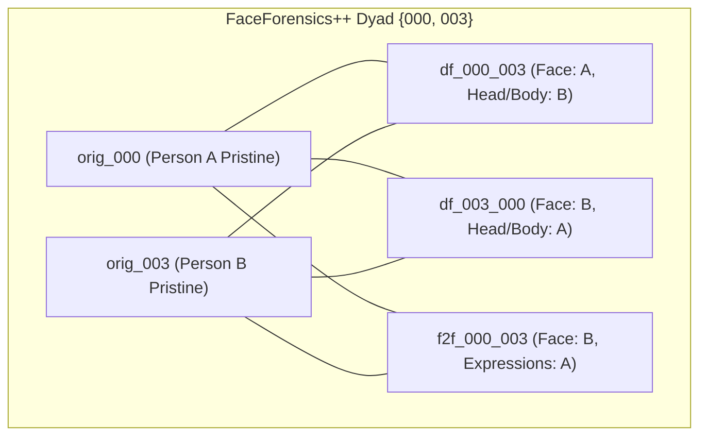

# Scientific Audit: Manifest Lineage and Group-ID Identity Validity for M13.2c

**Audit Date**: 2026-09-25  
**Artifact Inspected**: `manifests/mixed_robust_full.csv` (5,253 samples)  
**Primary Research Question**: Does `group_id` genuinely represent identity/lineage in a scientifically valid way for representation disentanglement?

---

## 1. Executive Summary & Audit Verdict

| Audit Domain | Empirical Finding | Scientific Validity Verdict |
|---|---|---|
| **Split Isolation & Leakage** | 0 overlap across Train (1,990), Val (1,255), and Test (2,008) in both FF++ and Celeb-DF. | **PASS (100% Leakage-Free)** |
| **FF++ Group Structure** | Exactly 500 groups across 4,298 videos; all 500 groups contain both pristine and manipulated videos. | **PASS (100% Dyad Coverage)** |
| **FF++ Identity Definition** | Every group contains **exactly 2 pristine videos** ($s$ and $t$) and their mutual swaps ($s \to t$ and $t \to s$). | **QUALIFIED: Interaction Dyad $\{s, t\}$, NOT Single Identity** |
| **Celeb-DF Group Structure** | 59 celebrity identity groups (`celebdf_id0`..`id58`) + 300 YouTube-real singleton groups (`yt_X`). | **PASS (Source Celebrity Identity)** |
| **Batch Co-occurrence** | In random batch size 16, only 43.3% of batches contain positive pairs; in batch size 32, 91.5% do. | **REQUIRES PAIR-AWARE SAMPLING** |

### Formal Verdict
**PASS WITH SCIENTIFIC CLARIFICATION**:  
`group_id` is structurally and mathematically valid as a **lineage / interaction dyad** identifier, but does **not** represent an individual biological identity in FaceForensics++. Instead, it clusters the **two interacting actors $\{s, t\}$** that form the closed swap loop. In Celeb-DF, `group_id` represents the **source celebrity identity** for synthesized clips.

Consequently, Milestone 13.2c evaluates **Lineage / Dyad Disentanglement**. To determine whether this supervision produces genuine representation disentanglement or acts as a generic contrastive regularizer, a **Shuffled-Group Negative Control** is strictly required.

---

## 2. Quantitative Dataset Breakdown

### A. FaceForensics++ C23 ($N=4,298$)
* **Unique `group_id`s**: 500
* **Group Size Distribution**:
  * Min: 8 videos per group (2 pristine + 2 Deepfakes + 2 FaceSwap + 2 NeuralTextures)
  * Max: 10 videos per group (includes Face2Face pairs in test/validation holdouts)
  * Mean: 8.60, Median: 8.0, IQR: [8.0, 10.0]
* **Real / Fake Co-occurrence**:
  * Groups with BOTH real and fake: **500 / 500 (100.0%)**
  * Groups with only real: 0 (0.0%)
  * Groups with only fake: 0 (0.0%)
* **Pristine Video Multiplicity**:
  * In every single group, there are **exactly 2 pristine videos** (e.g. `orig_000` and `orig_003` in `ffpp_0`; `orig_001` and `orig_870` in `ffpp_1`).

### B. Celeb-DF v2 ($N=955$)
* **Unique `group_id`s**: 359
* **Group Breakdown**:
  * **59 Celebrity Identity Groups** (`celebdf_id0` through `celebdf_id58`): Contain pristine celebrity clips (e.g. `id0_0001`) and multiple synthesized deepfakes targeting or sourced from that celebrity (e.g. `id0_id16_0003`, `id0_id1_0000`). Mean size: 11.1 videos.
  * **300 YouTube-Real Singletons** (`yt_00000` through `yt_00299`): Authentic individual videos of non-celebrity YouTube subjects (group size = 1, pristine only).
* **Real / Fake Co-occurrence**:
  * Groups with BOTH real and fake: 54 (15.0%)
  * Groups with only real: 302 (84.1%, predominantly YouTube-real singletons)
  * Groups with only fake: 3 (0.8%)

---

## 3. The Chimeric Identity Problem in Deepfake Disentanglement

A key discovery of this audit is that **identity is not monolithic in deepfakes**:

1. **FaceSwap / Deepfakes**: Inner facial features come from source $s$, while head shape, hair, ears, and background come from target $t$.
2. **Face2Face (Expression Reenactment)**: The facial identity, skin texture, and hair belong entirely to target $t$; only the expression dynamics (mouth/eyes) are driven by source $s$.
3. **Implication for Disentanglement**:
   - `group_id` encompasses the entire interaction dyad $\{s, t\}$.
   - When identity contrastive loss pulls samples of `group_id` together, it pulls together the **shared scene/lineage context** of actors $s$ and $t$.
   - This prevents the network from using the specific facial geometry or lighting conditions of dyad $\{s, t\}$ to distinguish real from fake.

---

## 4. Sampling Dynamics & Positive Pair Availability

In random mini-batch sampling:
* **Batch Size 16**: Only **43.3%** of batches contain at least one positive pair from the same `group_id`. Average positive pairs per batch: **1.12 / 16**.
* **Batch Size 32**: **91.5%** of batches contain at least one positive pair. Average positive pairs per batch: **4.16 / 32**.

**Engineering Requirement for M13.2c**:
To prevent degenerate contrastive gradients (where batches have 0 positive pairs), the DataLoader must use:
1. Batch size $\ge 32$ (or 16 with dyad co-sampling).
2. Contrastive loss formulation that gracefully skips samples that lack positive pairs in the current batch:
   $$\mathcal{L}_{\text{id\_con}} = \frac{1}{|\{i: |\mathcal{P}(i)| > 0\}|} \sum_{i: |\mathcal{P}(i)| > 0} \mathcal{L}_{\text{SupCon}}(i)$$

---

## 5. Required Experimental Controls for Milestone 13.2c

To rigorously evaluate the Disentanglement Hypothesis without confounding, the following three configurations must be compared against the frozen baseline `M13.2b-Stage5`:

1. **M13.2c-TrueGroup (Full Disentanglement)**:
   - Uses genuine `group_id` for identity contrastive loss $\mathcal{L}_{\text{id\_con}}$.
   - Subspace orthogonality constraint $\mathcal{L}_{\text{orth}}$ between $\mathbf{z}_{\text{id}}$ and $\mathbf{z}_{\text{manip}}$.
   - Classification heads attached strictly to $\mathbf{z}_{\text{manip}}$ + Stage-5 spatial head.
2. **M13.2c-ShuffledGroup (Negative Control)**:
   - Replaces `group_id` with randomly permuted group labels before each epoch.
   - Preserves identical network architecture, loss weights, and optimization dynamics.
   - *Scientific Purpose*: If TrueGroup outperforms ShuffledGroup, the identity supervision is **causal**. If ShuffledGroup performs identically to TrueGroup, the contrastive term is merely acting as a generic cluster regularizer.
3. **M13.2c-OrthOnly (Ablation without Contrastive Loss)**:
   - Applies dual projection heads and orthogonality loss $\mathcal{L}_{\text{orth}}$ without contrastive losses ($\lambda_{\text{con}} = 0$).
   - *Scientific Purpose*: Determines whether subspace decorrelation alone is sufficient without explicit identity supervision.

---

## 6. Audit Conclusion
The manifest and `group_id` are **scientifically sound** for lineage/dyad disentanglement. The experimental protocol will proceed with the required ablations and the shuffled-group negative control to definitively answer the research question.
