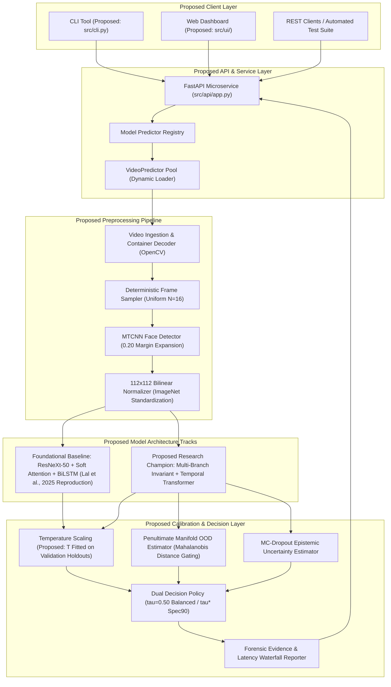

# DeepGuard: Proposed System Architecture & Technical Design

**Document ID**: `DG-ARCH-PROP-V1`  
**Phase**: Initial Project Proposal & Technical Specification  
**Course**: Image and Video Processing (IVP) — Group 10  
**Date**: October 2026  

---

## 1. System Overview & Proposed Architecture

DeepGuard is proposed as an explainable, modular visual deepfake video detection and digital forensic analysis platform. The proposed system will ingest standard digital video containers, execute deterministic temporal frame sampling, localize facial regions via MTCNN, standardize facial crops to $112 \times 112$ pixels, pass sequences through candidate spatial-temporal neural network pipelines, and produce temperature-calibrated probabilities, out-of-distribution (OOD) flags, and multi-branch forensic evidence.



---

## 2. Proposed Inference Workflow: Base Reproduction vs. Research Extension

DeepGuard explicitly distinguishes between the **Foundational Baseline** (direct reproduction of Lal et al., 2025) and the **Proposed Multi-Branch Extension** designed to overcome within-manifold generalization limitations:

```mermaid
flowchart TD
    INPUT["Video Input (1080p MP4 / AVI / MOV)"] --> SAMPLE["Uniform Temporal Sampler (16 Equidistant Frames)"]
    SAMPLE --> DETECT["MTCNN Face Detection & Bounding Box Expansion (0.20 Margin)"]
    DETECT --> PREPROC["Bilinear Rescale to 112x112 & ImageNet Normalization (Tensor: [1, 16, 3, 112, 112])"]

    PREPROC --> FORK{"Architecture Track"}

    subgraph Foundational Baseline Path (Lal et al., 2025)
        FORK -->|"Track A: Base Reproduction"| RN50["ResNeXt-50 32x4d Backbone (Output: [16, 2048, 4, 4])"]
        RN50 --> SOFT_ATTN["Soft Spatial Attention: Conv2d(2048, 1, 1x1) + Spatial Softmax"]
        SOFT_ATTN --> POOL_ATTN["Attended Spatial Pooling: Weighted Sum -> Feature [16, 2048]"]
        POOL_ATTN --> BILSTM["Bidirectional LSTM (2 Layers, Hidden=1024/dir -> 2048-dim sequence)"]
        BILSTM --> TEMP_POOL["Temporal Mean Pooling & Dropout (p=0.50)"]
        TEMP_POOL --> FC_V1["Linear Head: 2048 -> 1 Logit"]
    end

    subgraph Proposed Multi-Branch Extension Path
        FORK -->|"Track B: Multi-Branch Extension"| EFFB0["EfficientNet-B0 Backbone (Feature Stem)"]
        EFFB0 --> BRANCH_STEM["Multi-Scale Feature Decomposition"]
        BRANCH_STEM --> MID_SPATIAL["Mid-Spatial Stage 5 Branch (Captures Boundary Seams)"]
        BRANCH_STEM --> FREQ_BRANCH["High-Frequency Residual Branch (Laplacian / SRM Filters)"]
        BRANCH_STEM --> TEXT_BRANCH["Texture Anomaly Branch (High-Pass Spatial Gradients)"]
        
        MID_SPATIAL --> TR_ENC["Temporal Transformer Encoder (4 Heads, Dim=1280)"]
        FREQ_BRANCH --> TR_ENC
        TEXT_BRANCH --> TR_ENC

        TR_ENC --> FUSION_HEAD["Multi-Branch Gated Evidence Fusion Head"]
        FUSION_HEAD --> RAW_LOGITS["Composite Logit z + Individual Branch Logits"]
    end

    FC_V1 --> CALIB["Post-Hoc Temperature Scaling: p_cal = sigmoid(z / T)"]
    RAW_LOGITS --> CALIB

    CALIB --> OOD_CHECK{"Penultimate Mahalanobis d > Threshold?"}
    OOD_CHECK -->|"Yes (OOD)"| FLAG_OOD["Flag Distribution Shift / High Epistemic Uncertainty"]
    OOD_CHECK -->|"No"| IN_DIST["In-Distribution Evaluation"]

    FLAG_OOD --> DECIDE["Dual Decision Policy (tau=0.50 Balanced or tau* High Sensitivity)"]
    IN_DIST --> DECIDE

    DECIDE --> OUTPUT["Calibrated Verdict: REAL / DEEPFAKE + Forensic Evidence Report"]
```

---

## 3. Subsystem Module Breakdown

| Subsystem Module | Planned Source Location | Primary Role & Operational Contract |
|---|---|---|
| **Video Ingestion & Sampler** | `src/data/video.py` | OpenCV video decoding; verifies $\ge 16$ frames; extracts deterministic equidistant sequence. |
| **Face Detection & Preprocessor** | `src/data/detector.py`, `src/data/preprocessor.py` | MTCNN face detection with 0.20 margin expansion; bilinear resizing to $112 \times 112 \times 3$; ImageNet normalization. |
| **Spatial Backbone & Attention** | `src/models/backbones/`, `src/models/attention/` | ResNeXt-50 / EfficientNet-B0 feature extraction; soft spatial attention Conv2d weighting. |
| **Temporal Sequence Model** | `src/models/temporal/` | Multi-frame temporal sequence modeling comparing Bidirectional LSTM against Temporal Transformer encoders. |
| **Calibration & OOD Layer** | `src/uncertainty/` | Temperature scaling calibration; Mahalanobis distance OOD gating; Monte Carlo dropout epistemic variance. |
| **FastAPI Microservice** | `src/api/app.py` | Asynchronous RESTful microservice handling video uploads, model selection, and JSON reporting. |
| **Web Dashboard** | `src/ui/` | Glassmorphic dark dashboard with video preview, interactive threshold slider, and latency waterfall. |

---

## 4. Hardware Optimization Strategy for NVIDIA RTX 3050 (6GB)

1. **Mixed Precision (AMP FP16)**: Automatic mixed precision will be utilized during both training and inference to reduce activation VRAM by approximately 45%.
2. **Micro-Batching & Gradient Accumulation**: To prevent Out-Of-Memory (OOM) errors during training, a micro-batch size of 4 with 2 accumulation steps will simulate an effective batch size of 8.
3. **Cumulative Freezing**: Backbone stems will remain frozen during initial epochs, training only attention and temporal projection layers.
4. **Target Footprint**: Total peak dedicated GPU memory will be constrained to $< 1.0$ GB during inference, ensuring compatibility with consumer laptops.
